  
  &nbsp;
  
  &nbsp;
  

## About

<b>English</b>

 

I work on both sides of the same problem: I build software, and I build the tools that test it. Most of what is public here is security tooling written for the terminal: a reconnaissance framework mapped to MITRE ATT&CK, an authenticated encryption toolkit on top of OpenSSL, and the automation I wrote for a SOC team. Alongside it I ship web and mobile products with Next.js and Flutter.

<b>Français</b>

 

Je travaille des deux côtés du même problème : je construis des logiciels, et je construis les outils qui les mettent à l'épreuve. L'essentiel de ce qui est public ici, ce sont des outils de sécurité pour le terminal : un framework de reconnaissance aligné sur MITRE ATT&CK, une boîte à outils de chiffrement authentifié au-dessus d'OpenSSL, et l'automatisation que j'ai écrite pour une équipe SOC. En parallèle, je livre des produits web et mobiles avec Next.js et Flutter.

<b>Español</b>

 

Trabajo en los dos lados del mismo problema: construyo software, y construyo las herramientas que lo ponen a prueba. La mayor parte de lo que es público aquí son herramientas de seguridad para la terminal: un framework de reconocimiento alineado con MITRE ATT&CK, un conjunto de herramientas de cifrado autenticado sobre OpenSSL, y la automatización que escribí para un equipo SOC. En paralelo, entrego productos web y móviles con Next.js y Flutter.

## Selected work

  
  
  
  
  
  

Also here: [code-altice](https://github.com/mpgamer75/code-altice), the failed-login report generator from the same SOC internship, [ps-installation](https://github.com/mpgamer75/ps-installation), PowerShell utilities that bring the commands I miss from Linux to Windows, and [medcare](https://github.com/mpgamer75/medcare), a Flutter app for tracking chronic-illness treatments.

## Stack

## Activity

  Every panel on this page is an SVG built by <a href="scripts/build.mjs">one script</a>; the activity ones are refreshed daily by a GitHub Action. 
  The terminal shows a real hexdump, so <code>xxd -r -p</code> on the bytes in the footer gives the text back. 
  On repeat: <a href="https://open.spotify.com/track/3sK8wGT43QFpWrvNQsrQya">DtMF</a>.

