<a href="https://portfolio-six-sigma-3vo8pbx95b.vercel.app"><picture><source media="(max-width: 700px)" srcset="assets/m/hero.svg"></picture></a>

  
  &nbsp;
  
  &nbsp;
  

<picture><source media="(max-width: 700px)" srcset="assets/m/terminal.svg"></picture>

## About

<picture><source media="(max-width: 700px)" srcset="assets/m/about-en.svg"></picture>

<b>Français</b>

 
<picture><source media="(max-width: 700px)" srcset="assets/m/about-fr.svg"></picture>

<b>Español</b>

 
<picture><source media="(max-width: 700px)" srcset="assets/m/about-es.svg"></picture>

## Selected work

<a href="https://lanjo.vercel.app"><picture><source media="(max-width: 700px)" srcset="assets/m/card-lanjo.svg"></picture></a>

<a href="https://mi-saludrd.com"><picture><source media="(max-width: 700px)" srcset="assets/m/card-saludrd.svg"></picture></a>

<a href="https://github.com/mpgamer75/security-scanner"><picture><source media="(max-width: 700px)" srcset="assets/m/card-security-scanner.svg"></picture></a>

<a href="https://github.com/mpgamer75/encryptor"><picture><source media="(max-width: 700px)" srcset="assets/m/card-encryptor.svg"></picture></a>

<a href="https://github.com/mpgamer75/SOC_Automation"><picture><source media="(max-width: 700px)" srcset="assets/m/card-soc-automation.svg"></picture></a>

<a href="https://github.com/mpgamer75/Portfolio"><picture><source media="(max-width: 700px)" srcset="assets/m/card-portfolio.svg"></picture></a>

<a href="https://orthoprotesis-francis-valerio.vercel.app"><picture><source media="(max-width: 700px)" srcset="assets/m/card-dental-clinic.svg"></picture></a>

<a href="https://github.com/mpgamer75/Warhammer-40k-terminal-display"><picture><source media="(max-width: 700px)" srcset="assets/m/card-imperial-terminal.svg"></picture></a>

Also here: [code-altice](https://github.com/mpgamer75/code-altice), the failed-login report generator from the same SOC internship, [ps-installation](https://github.com/mpgamer75/ps-installation), PowerShell utilities that bring the commands I miss from Linux to Windows, and [medcare](https://github.com/mpgamer75/medcare), a Flutter app for tracking chronic-illness treatments.

## Stack

<picture><source media="(max-width: 700px)" srcset="assets/m/stack.svg"></picture>

## Activity

<picture><source media="(max-width: 700px)" srcset="assets/m/activity.svg"></picture>

<picture><source media="(max-width: 700px)" srcset="assets/m/languages.svg"></picture>

## Trophies

<picture><source media="(max-width: 700px)" srcset="assets/m/trophies.svg"></picture>

  <a href="https://github.com/mpgamer75?tab=achievements">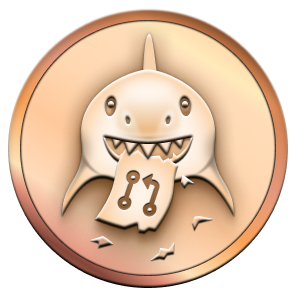</a>
  &nbsp;&nbsp;
  <a href="https://github.com/mpgamer75?tab=achievements">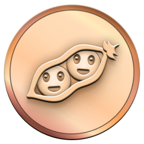</a>
  &nbsp;&nbsp;
  
   
  <b>Pull Shark x2</b> &nbsp;·&nbsp; <b>Pair Extraordinaire x2</b> &nbsp;·&nbsp; <b>YOLO</b>

<picture><source media="(max-width: 700px)" srcset="assets/m/footer.svg"></picture>
