<picture>
  <source media="(prefers-color-scheme: dark)" srcset="assets/hero-dark.svg">
  <source media="(prefers-color-scheme: light)" srcset="assets/hero-light.svg">
  
</picture>

<br>

I work on both sides of the same problem: I build software, and I build the tools that test it. Most of what is public here is security tooling written for the terminal, plus the web and mobile projects I ship alongside it.

<p>
  <a href="https://portfolio-six-sigma-3vo8pbx95b.vercel.app"><b>Portfolio</b></a>
  &nbsp;·&nbsp;
  <a href="https://www.linkedin.com/in/charles-lantigua-jorge-2b63132a4/"><b>LinkedIn</b></a>
  &nbsp;·&nbsp;
  <a href="https://github.com/mpgamer75?tab=repositories"><b>All repositories</b></a>
</p>

## Selected work

<table>
  <tr>
    <td width="50%" valign="top">
      <h3><a href="https://github.com/mpgamer75/security-scanner">security-scanner</a></h3>
      <p>Reconnaissance tool for authorized penetration tests. Runs an OSINT, network and web
      workflow, tags findings with MITRE ATT&amp;CK technique IDs, and writes a self-contained
      offline HTML report with a Navigator layer.</p>
      <sub><code>Bash</code> <code>Python</code> <code>Docker</code></sub>
    </td>
    <td width="50%" valign="top">
      <h3><a href="https://github.com/mpgamer75/encryptor">encryptor</a></h3>
      <p>Authenticated file encryption and X.509 toolkit in nothing but Bash and OpenSSL.
      Encrypt-then-MAC container, scrypt key derivation, certificate recipients, and a format
      you can decrypt by hand with stock <code>openssl</code>.</p>
      <sub><code>Bash</code> <code>OpenSSL</code> <code>CI tested</code></sub>
    </td>
  </tr>
  <tr>
    <td width="50%" valign="top">
      <h3><a href="https://github.com/mpgamer75/SOC_Automation">SOC automation</a></h3>
      <p>Tooling written for the SOC team at Altice Dominicana during my internship: a desktop
      file comparator for analyst exports, and a
      <a href="https://github.com/mpgamer75/code-altice">report generator</a> that turns
      failed-login logs into consolidated reports.</p>
      <sub><code>Python</code> <code>TypeScript</code> <code>SQLite</code></sub>
    </td>
    <td width="50%" valign="top">
      <h3><a href="https://github.com/mpgamer75/Portfolio">Portfolio</a></h3>
      <p>My personal site. The skills section is an orbital map rendered in WebGL with
      hand-written shaders and no textures.
      <a href="https://portfolio-six-sigma-3vo8pbx95b.vercel.app">See it live.</a></p>
      <sub><code>Next.js</code> <code>TypeScript</code> <code>WebGL</code></sub>
    </td>
  </tr>
  <tr>
    <td width="50%" valign="top">
      <h3><a href="https://github.com/mpgamer75/dental-clinic">dental-clinic</a></h3>
      <p>Production website for a dental clinic in Santiago de los Caballeros, Dominican Republic.
      <a href="https://orthoprotesis-francis-valerio.vercel.app">See it live.</a></p>
      <sub><code>TypeScript</code> <code>Vercel</code></sub>
    </td>
    <td width="50%" valign="top">
      <h3><a href="https://github.com/mpgamer75/Warhammer-40k-terminal-display">Imperial terminal</a></h3>
      <p>The one I made for fun: a Warhammer 40K theme for zsh and bash with a dynamic prompt,
      around fifty commands and five playable chapters.</p>
      <sub><code>Zsh</code> <code>Bash</code> <code>ShellCheck</code></sub>
    </td>
  </tr>
</table>

Also here: [ps-installation](https://github.com/mpgamer75/ps-installation), PowerShell utilities that bring the commands I miss from Linux to Windows, and [medcare](https://github.com/mpgamer75/medcare), a Flutter app for tracking chronic-illness treatments.

## Toolbox

<table>
  <tr><td><b>Security</b></td><td>Reconnaissance and OSINT · MITRE ATT&amp;CK · nmap · OpenSSL · X.509 and PKI · SOC tooling</td></tr>
  <tr><td><b>Languages</b></td><td>Bash · Python · TypeScript · JavaScript · PowerShell · Dart · Java · C</td></tr>
  <tr><td><b>Web and mobile</b></td><td>Next.js · React · Tailwind CSS · Flutter</td></tr>
  <tr><td><b>Data</b></td><td>PostgreSQL · Supabase · Firebase · SQLite</td></tr>
  <tr><td><b>Systems</b></td><td>Linux · Docker · GitHub Actions</td></tr>
</table>

## Activity

<picture>
  <source media="(prefers-color-scheme: dark)" srcset="assets/activity-dark.svg">
  <source media="(prefers-color-scheme: light)" srcset="assets/activity-light.svg">
  
</picture>

<br>

<picture>
  <source media="(prefers-color-scheme: dark)" srcset="assets/languages-dark.svg">
  <source media="(prefers-color-scheme: light)" srcset="assets/languages-light.svg">
  
</picture>

<br>

<sub>The panels on this page are plain SVG built by <a href="scripts/build.mjs">one script</a> and refreshed daily by a GitHub Action. The header is a real hexdump, so <code>xxd -r -p</code> will give it back to you:</sub>

```
436861726c6573204c616e7469677561204a6f7267650a6379626572736563757269747920656e67696e656572202f20
736f66747761726520656e67696e6565720a50617269732c2046520a6769746875622e636f6d2f6d7067616d657237350a
```

<sub>On repeat: <a href="https://open.spotify.com/track/3sK8wGT43QFpWrvNQsrQya">DtMF</a>.</sub>
